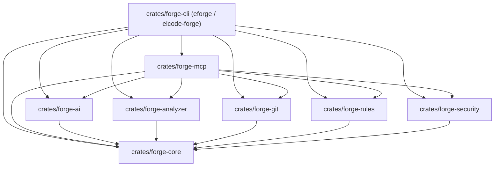

# ELCODE Forge (`eforge`) v1.1.0

> **Know your code. Ship with confidence.**  
> Deterministic Codebase Intelligence, Tactile Terminal Instrument, Active Remediation, Architecture Analysis, Change Blast-Radius & Native Closed-Loop MCP Engine — built in Rust by **[ELCODE](https://elcode.id/)**.

[](https://github.com/elcode-id/elcode-forge/actions/workflows/ci-rust.yml)
[](https://github.com/elcode-id/elcode-forge/actions/workflows/ci-web.yml)
[](https://github.com/elcode-id/elcode-forge/actions/workflows/ci-server.yml)
[](https://github.com/elcode-id/elcode-forge/actions/workflows/eforge-dogfood.yml)
[](https://github.com/elcode-id/elcode-forge/actions/workflows/security-durability.yml)
[](https://github.com/elcode-id/elcode-forge/releases)
[](./LICENSE)
[](https://www.rust-lang.org)

---

## Why ELCODE Forge?

Modern codebases grow faster than teams can map them—especially with AI-assisted coding. Most developer tools either check syntax at the single-file level (linters) or send unindexed source trees to an LLM and hope for the best.

**ELCODE Forge (`eforge`)** is a **local-first, deterministic codebase intelligence and active remediation layer**. Before any AI model or code reviewer looks at a repository, `eforge` builds a normalized **Intermediate Representation (IR)** of your repository's files, module boundaries, import graph, circular dependencies, npm/pnpm/Cargo manifest hygiene, Git blast radius, security/secret signals, and an **explainable 8-dimension Health Score**—and exposes it via a high-speed CLI, an interactive Terminal UI (`eforge ui`), a live file-save architectural radar (`eforge watch`), surgical transactional codemods (`eforge fix`), a zero-telemetry Web Dashboard, and a native **Model Context Protocol (MCP)** server (`eforge mcp`).

### The ELCODE Studio Manifesto (`elcode.id`)

Every architectural boundary, CLI contract, and CI/CD workflow in `elcode-forge` is engineered around the five studio principles of **[ELCODE](https://elcode.id/)**:

| # | Studio Principle | How It Manifests in `elcode-forge` |
| :---: | :--- | :--- |
| **`01`** | **Software should feel like an instrument, not a compromise.** | Collision-free **`eforge`** binary (`elcode-forge` alias), interactive `ratatui` TUI (`eforge ui`), box-drawn `--codeframe` diagnostics, deterministic exit codes (`0..=4`), single-file **`eforge.config.yaml`**, and instant local execution without cloud lock-in. |
| **`02`** | **Code quality is visible in product behavior, speed, and durability.** | **Behavior:** Zero-panic Rust engine (`unsafe_code = "forbid"`, zero `.unwrap()`/`.expect()` in library crates).<br>**Speed:** `eforge doctor` completes in **`~18–65ms`** and incremental `eforge watch` cycles complete in **`< 50ms`** using `blake3` file-level AST caching (`.eforge/cache/`).<br>**Durability:** Strict crate DAG, canonical `ReportBundle` JSON Schema drift enforcement, and continuous supply-chain auditing (`cargo audit`). |
| **`03`** | **We use AI as leverage, not as identity.** | **Deterministic before generative.** All AI outputs (`eforge explain --ai`, `eforge ai-review`) and pre-flight MCP agent verifications (`eforge_verify_patch`, `eforge_get_pruned_context`) are grounded against the deterministic IR, isolated inside `<untrusted_repository_data>` envelopes, and support offline local models (Ollama / LM Studio). |
| **`04`** | **We prefer precision over decoration.** | Byte-for-byte reproducible JSON, Markdown, and OASIS SARIF v2.1.0 output (`BTreeMap`/`BTreeSet` ordering). Every finding carries explicit `severity`, `confidence`, file/line span, visual call-chain arrows, and mathematical 8-dimension health score deductions—zero vague scores or decorative fluff. |
| **`05`** | **We build things worth keeping.** | Transactional rollback-safe codemods (`.eforge/tx/`), self-contained offline dashboard bundles (`eforge report`), append-only historical commit trend tracking (`eforge trend`, `.eforge/history/`), and automated living onboarding documentation (`eforge onboard`). |

---

## Key Capabilities

| Capability | Description |
| :--- | :--- |
| **Interactive Terminal UI (`eforge ui`, `-i`)** | Launches a keyboard-driven `ratatui` terminal instrument with 4 real-time views: `[1] DAG Explorer` (fan-in/fan-out/instability), `[2] Tarjan SCC Cycles`, `[3] Blast Radius`, and `[4] Findings & Code-Frame`. Also available via `--interactive` (`-i`) on `doctor`, `scan`, and `review`. |
| **Rich Code-Frame Diagnostics (`--codeframe`)** | Renders multi-line box-drawn source spans (`╭─[...]`, `│`, `╰──▶`), inline carets (`^`), visual call-chain hop arrows for circular dependencies, and unified diff (`-` / `+`) autofix previews directly in the terminal. |
| **Live Architectural Radar (`eforge watch`)** | Monitors source files and leverages incremental `blake3` file-level AST caching (`.eforge/cache/file-ast-v1.json`) to re-evaluate architecture boundaries and 8-Dimension Health Score deltas in **`< 50ms`** on every file save. |
| **Surgical Auto-Fix & Rollback (`eforge fix`)** | Generates and applies deterministic codemods (`--dry-run`, `--apply`, `--rule <id>`) with atomic transaction backups in `.eforge/tx/<tx_id>/` and instant byte-for-byte rollback (`eforge fix --rollback`). |
| **In-Memory Refactor Simulator (`eforge simulate`)** | Simulates moving files or modules (`--move <from:to>` or `--plan <yaml>`) entirely in memory—predicting relative import rewrites, resolved/introduced Tarjan SCC cycles, and Health Score deltas before touching disk. |
| **Temporal Evolution & Arch Blame (`eforge trend`, `eforge blame-arch`)** | Computes historical 8-Dimension Health Score evolution, architectural drift, composite hotspots (`Churn × Fan-In × Severity`), and git-blame attribution for exact commits that introduced boundary violations. |
| **Topology & Boundary Inference (`eforge rules infer`, `eforge init --infer`)** | Analyzes module fan-in, fan-out, and instability $I = \frac{\text{FanOut}}{\text{FanIn} + \text{FanOut}}$ to classify architectural layers (`UI`, `Service`, `Domain`, `Data`, `Infra`, `Shared`), detect project archetype (`Clean / Hexagonal`, `Layered N-Tier`, `Feature-Sliced`), and synthesize custom `forbidden_imports` rules. |
| **Smart Impacted Test Selection (`eforge review --impacted-tests`)** | Traverses reverse transitive module and file imports from a working-tree diff to select the exact subset of test files impacted by a change and outputs ready-to-run test runner commands (`vitest`, `cargo test`, `pytest`, `go test`). |
| **Fast Project Diagnosis (`eforge doctor`)** | Diagnoses repository inventory, languages, frameworks (Node/TS/JS, Python, Go, Rust, PHP), lockfile hygiene, test suite presence, and secret exposure in **< 5 seconds** (~4–18ms on small/medium repos). |
| **Declarative Rules & Rule Packs (`eforge rules`)** | Enforces custom architectural, quality, security, and dependency boundaries using 6 deterministic matchers (`forbidden_imports`, `required_companion`, `file_naming`, `file_size`, `regex_pattern`, `dependency_restriction`) and 4 pre-built packs (`recommended`, `strict`, `security`, `clean-architecture`). See [docs/RULES_GUIDE.md](./docs/RULES_GUIDE.md). |
| **Architecture Graph & Cycle Detection (`eforge graph`)** | Infers logical module boundaries across TypeScript, JavaScript, Python, Go, Rust, and PHP (including `.vue`/`.svelte` SFCs and path aliases) and detects circular dependencies via **Tarjan's Strongly Connected Components (SCC)** algorithm. |
| **Dependency Health Intelligence (`eforge dependencies`)** | Analyzes multi-ecosystem package manifests across **npm**, **PyPI**, **Go**, **Cargo**, and **Composer** to flag unused production dependencies (`deps/unused-dependency`), wildcard/unpinned versions (`deps/unpinned-version`), and duplicate declarations (`deps/duplicate-dependency`). |
| **Deep Security & Vulnerability Audit (`eforge security --audit`)** | Audits dependencies across npm, PyPI, Go, Cargo, and Composer against the Open Source Vulnerabilities (OSV) database and GHSA with CVSS scores, remediation suggestions, and SARIF exports. See [docs/SECURITY_GUIDE.md](./docs/SECURITY_GUIDE.md). |
| **Software Bill of Materials (`eforge sbom`)** | Generates NTIA-compliant **CycloneDX v1.5 JSON** and **SPDX v2.3 JSON** SBOMs with canonical Package URLs (PURL) and deterministic BLAKE3 serial numbers for polyglot codebases. |
| **Native Closed-Loop MCP Server (`eforge mcp`)** | Exposes **11 deterministic `eforge_*` tools** over JSON-RPC 2.0 stdio—including pre-flight patch verification (`eforge_verify_patch`), refactor simulation (`eforge_simulate_refactor`), impacted test selection (`eforge_get_impacted_tests`), and graph-centrality token pruning (`eforge_get_pruned_context`)—all wrapped in `UntrustedEnvelope<T>`. |
| **Policy-as-Code & Compliance (`eforge policy check`, `eforge audit`)** | Enforces organization-wide health scores, blast-radius thresholds, and time-bounded waivers, and exports automated **SOC 2 Type II**, **OWASP Top 10**, and **ISO/IEC 27001** compliance reports. |
| **Self-Hosted Forge Server & Team Cloud Sync (`eforge sync`, `eforge push`, `eforge pull`)** | Synchronizes repository analysis baselines to a lightweight self-hostable backend (`forge-server`) with SQLite or PostgreSQL, historical branch retention, trend analytics, and real-time HMAC-SHA256 webhooks. See [docs/SELF_HOSTING.md](./docs/SELF_HOSTING.md). |

---

## Multi-Language & Ecosystem Support Matrix

ELCODE Forge provides unified polyglot scanning across 6 core languages with native AST/import analysis, circular dependency detection, and dependency hygiene:

| Ecosystem / Language | File Extensions | Manifest & Lockfiles | Frameworks & Detectors | Import Resolution |
| :--- | :--- | :--- | :--- | :--- |
| **TypeScript / JavaScript** | `.ts`, `.tsx`, `.js`, `.jsx`, `.svelte`, `.vue` | `package.json`, `package-lock.json`, `pnpm-lock.yaml`, `yarn.lock`, `bun.lockb` | Next.js, Nuxt, SvelteKit, React, Vue, Svelte, Express, NestJS | Relative, index, `@/` and `~/` aliases, SFC script tags |
| **Python** | `.py`, `.pyi` | `pyproject.toml`, `requirements.txt`, `poetry.lock`, `Pipfile.lock` | FastAPI, Flask, Django, Pytest, Celery, SQLAlchemy | Absolute, intra-package relative (`.`, `..`), stdlib filtering |
| **Go** | `.go` | `go.mod`, `go.sum` | Gin, Echo, Fiber, Chi, Go testing | Go module root resolution, intra-module package imports, stdlib filtering |
| **Rust** | `.rs` | `Cargo.toml`, `Cargo.lock` | Axum, Actix-web, Tokio, Rocket, Cargo test | Workspace crate resolution, inline `mod`, `crate::`, `super::`, `self::` |
| **PHP** | `.php` | `composer.json`, `composer.lock` | Laravel, Symfony, WordPress, PHPUnit, Pest | PSR-4 namespace mappings (`App\` -> `app/`), single/aliased/group `use` statements, stdlib filtering |

For detailed architectural and resolution documentation, see [docs/MULTI_LANGUAGE.md](./docs/MULTI_LANGUAGE.md).

---

## Installation & Distribution

### 1. Zero-Install Execution via npx (Node.js)
No installation required—execute directly in any Node.js / JavaScript / TypeScript project:
```bash
npx elcode-forge doctor
npx elcode-forge scan --codeframe
npx elcode-forge review --fast --impacted-tests
```

### 2. Standalone Installers (Linux, macOS & Windows)
**POSIX (Linux & macOS):**
```bash
curl -fsSL https://raw.githubusercontent.com/elcode-id/elcode-forge/main/scripts/install.sh | bash
```

**Windows (PowerShell):**
```powershell
irm https://raw.githubusercontent.com/elcode-id/elcode-forge/main/scripts/install.ps1 | iex
```

### 3. Package Managers & Binary Installers
**Homebrew (macOS & Linux):**
```bash
brew install elcode-id/tap/eforge
```

**Cargo Binstall (Pre-compiled Binary):**
```bash
cargo binstall eforge
```

**Build & Install from Source (Rust Toolchain >= 1.75):**
```bash
cargo install --path crates/forge-cli
```

Verify installation:
```bash
eforge --version
# ELCODE Forge (eforge) v1.1.0
```

### 4. Cryptographic Provenance & SLSA Level 3 Verification
All pre-compiled release binaries and archives are cryptographically signed using GitHub Artifact Attestations (Sigstore) and accompanied by SLSA Build Level 3 provenance. You can verify integrity before running:
```bash
# Verify with GitHub CLI (Sigstore Fulcio/Rekor)
gh attestation verify eforge-v1.1.0-x86_64-unknown-linux-gnu.tar.gz --owner elcode-id

# Or verify with OpenSSF slsa-verifier
slsa-verifier verify-artifact eforge-v1.1.0-x86_64-unknown-linux-gnu.tar.gz \
  --provenance-path multiple.intoto.jsonl \
  --source-uri github.com/elcode-id/elcode-forge
```
See the complete [Verification Guide (docs/VERIFICATION_GUIDE.md)](./docs/VERIFICATION_GUIDE.md) for step-by-step instructions across Linux, macOS, and Windows.

---

## Quick Start (The Golden Path)

### 1. Initialize Configuration & Infer Architecture (`eforge init`)
Generates a starter `eforge.config.yaml`, initializes the `.eforge/` incremental cache directory, and optionally infers module boundary rules from your import graph:
```bash
eforge init --path . --infer
```

### 2. Run a Fast Diagnostic Check (`eforge doctor`)
```bash
eforge doctor --path . --codeframe
```
```text
ELCODE Forge Doctor
-------------------
[ OK ] Repository inventory: Discovered 71 source/config file(s)
[ OK ] Language & framework detection: Languages: [rust], Frameworks: []
[ OK ] Cargo manifest & lockfile hygiene: Cargo.toml present, Cargo.lock present: true
[ OK ] Automated test suite: Found 26 test file(s)
[ OK ] Security & secret hygiene: No hardcoded secrets or unsafe patterns detected
[ OK ] Architectural & quality rules: Loaded 4 active rule(s) (packs: [recommended], custom: 0)

Summary: 0 warning(s) in 18ms
```

### 3. Explore Interactively or Watch in Real Time (`eforge ui` & `eforge watch`)
```bash
# Launch the 4-tab interactive terminal UI (DAG, Cycles, Blast Radius, Code-Frames)
eforge ui --path .

# Start the live <50ms incremental file-save architectural radar
eforge watch --path .
```

### 4. Declarative Rules & Topology Inference (`eforge rules`)
```bash
# Infer architectural archetype, layer instability, and boundary rules
eforge rules infer --write

# Initialize a starter custom rules template
eforge rules init

# List active rules and extended packs
eforge rules list

# Check rule syntax and schema without scanning
eforge rules check .eforge/rules/custom-rules.yaml
```

### 5. Execute a Full or Incremental Scan (`eforge scan`)
```bash
# Human-readable terminal report with rich box-drawn code frames
eforge scan --path . --codeframe

# Incremental scan using .eforge/metadata.json BLAKE3 hashes
eforge scan --path . --incremental

# Export OASIS SARIF v2.1.0 for GitHub Code Scanning
eforge scan --path . --format sarif --output eforge.sarif

# Enforce CI policy gate (non-zero exit code if High or Critical findings exist)
eforge scan --path . --fail-on high --format github
```

### 6. Surgical Auto-Fix, Refactor Simulation & Temporal Trends (`eforge fix`, `eforge simulate`, `eforge trend`)
```bash
# Preview deterministic codemods with unified diff previews
eforge fix --dry-run

# Apply fixes atomically with backup in .eforge/tx/<tx_id>/ and rollback if needed
eforge fix --apply
eforge fix --rollback

# Simulate moving a module in memory before touching disk
eforge simulate --move src/db/client.ts:src/infra/db/client.ts

# Inspect historical 8-Dimension Health Score drift & blame architectural violations
eforge trend --commits 20
eforge blame-arch
```

### 7. Review Working-Tree Changes & Smart Impacted Tests (`eforge review` & `eforge diff`)
```bash
# Fast diff-scoped review with exact impacted test selection
eforge review --fast --impacted-tests --path .

# Inspect direct and transitive module blast radius
eforge diff --path . --format terminal
```

### 8. Focused Architecture, Dependency, Security, SBOM & Explain Workflows
```bash
# Export Mermaid architecture graph
eforge graph --path . --format markdown

# Inspect npm/pnpm/Cargo/Go/PyPI dependency health
eforge dependencies --path . --format terminal

# Run dedicated secret, unsafe pattern & OSV vulnerability scan
eforge security --audit --path . --format sarif

# Export CycloneDX v1.5 or SPDX v2.3 Software Bill of Materials
eforge sbom --spec cyclonedx --output sbom.cdx.json

# Explain a specific module's files, imports, dependents, exports, and findings
eforge explain src/services --path fixtures/next-app --format markdown

# Generate deterministic 5-file onboarding & architecture documentation in docs/forge/
eforge onboard --path .
```

### 9. Native Git Hooks & Staged-Diff Scanner (`eforge hook`)
Install zero-dependency pre-commit and pre-push hooks that review staged changes in `< 200ms`:
```bash
eforge hook install
eforge hook status
eforge hook run pre-commit
eforge hook uninstall
```

### 10. AI-Assisted Explanations & Grounded PR Review
```bash
# Explain architecture or modules with AI-synthesized, grounded answers
eforge explain src/services --ai

# Preview prompt context pack & token estimates without making network calls
eforge explain src/services --ai --dry-run

# Run grounded AI PR review with Confirmed | Probable | Suggestion items
eforge ai-review --fast --fail-on high

# Check AI provider connectivity and inspect token spend
eforge ai status --ping
eforge ai usage
```

### 11. Team Cloud Synchronization (`eforge push`, `eforge pull`, `eforge sync`)
```bash
eforge login --server http://forge.internal:8080 --token YOUR_API_KEY
eforge push
eforge pull
eforge sync
eforge auth status
```

---

## CLI Command Reference (34 Commands / 41 Subcommands)

| Command | Key Flags | Description |
| :--- | :--- | :--- |
| `eforge init` | `--path <DIR>`, `--infer` | Initializes `eforge.config.yaml` and `.eforge/`, optionally inferring custom boundary rules (`--infer`). |
| `eforge doctor` | `--path <DIR>`, `-i, --interactive`, `--codeframe`, `--format <FMT>` | Runs a `< 5s` diagnostic check across inventory, manifest hygiene, tests, rules, and secrets. |
| `eforge scan` | `--path <DIR>`, `--incremental`, `--full`, `-i, --interactive`, `--codeframe`, `--fail-on <SEV>`, `--format <FMT>`, `-o <FILE>` | Runs full or incremental architecture, dependency, rule, security, and 8-dimension health analysis. |
| `eforge ui` | `--path <DIR>`, `--tab <1..=4>` | Launches the interactive `ratatui` terminal instrument (DAG Explorer, Tarjan SCC Cycles, Blast Radius, Findings & Code-Frame). |
| `eforge watch` | `--path <DIR>`, `--debounce-ms <MS>`, `--once`, `--format <FMT>` | Live incremental architectural radar using `.eforge/cache/file-ast-v1.json` (`< 50ms` re-evaluation on file save). |
| `eforge fix` | `--path <DIR>`, `--dry-run`, `--apply`, `--rule <ID>`, `--rollback [TX_ID]`, `--format <FMT>` | Surgical deterministic auto-fix engine with transactional backup in `.eforge/tx/<tx_id>/` and rollback. |
| `eforge simulate` | `--path <DIR>`, `--move <FROM:TO>`, `--plan <YAML>`, `--format <FMT>` | Simulates file/module moves in memory and reports import rewrites, cycle changes, and health delta. |
| `eforge trend` | `--path <DIR>`, `--commits <N>`, `--format <FMT>` | Evaluates temporal 8-Dimension Health Score evolution, architectural drift, and composite hotspots (`Churn × Fan-In × Severity`). |
| `eforge blame-arch` | `--path <DIR>`, `--format <FMT>` | Attributes architectural and circular-dependency violations to the introducing Git commit and author. |
| `eforge review` | `--path <DIR>`, `--base <REF>`, `--head <REF>`, `--fast`, `--impacted-tests`, `-i, --interactive`, `--fail-on <SEV>`, `--format <FMT>` | Computes change risk (`Low|Medium|High|Critical`), blast radius, findings, and smart impacted test selection. |
| `eforge diff` | `--path <DIR>`, `--base <REF>`, `--head <REF>`, `--remote`, `--format <FMT>` | Parses working-tree or range diff (or `--remote` baseline) and reports direct & transitive module impact. |
| `eforge rules [list]` | `--path <DIR>`, `--category <CAT>`, `--enabled-only`, `--format <FMT>` | Lists all active rules, categories, severities, and origin packs. |
| `eforge rules check` | `[RULE_PATH]`, `--path <DIR>`, `--format <FMT>` | Validates rule syntax against schema with zero panics. |
| `eforge rules init` | `--path <DIR>`, `--force`, `--format <FMT>` | Generates starter `.eforge/rules/custom-rules.yaml` template with examples for all 6 matchers. |
| `eforge rules infer` | `--path <DIR>`, `--write`, `--format <FMT>` | Infers architectural archetype, module layers, and `forbidden_imports` boundary rules from the import graph. |
| `eforge policy check` | `--path <DIR>`, `--policy <FILE>`, `--fail-on <SEV>`, `--format <FMT>` | Evaluates organization Policy-as-Code constraints and time-bounded waivers. |
| `eforge audit` | `--path <DIR>`, `--standard <soc2\|owasp\|iso27001>`, `--format <FMT>`, `-o <FILE>` | Generates automated SOC 2 Type II, OWASP Top 10, or ISO/IEC 27001 compliance audit reports. |
| `eforge dependencies` | `--path <DIR>`, `--format <FMT>` | Inspects multi-ecosystem package manifests, unused packages, and version hygiene. |
| `eforge security` | `--path <DIR>`, `--audit`, `--offline`, `--fail-on <SEV>`, `--format <FMT>` | Runs secret detection, unsafe pattern analysis, license check, and OSV vulnerability audit (`--audit`). |
| `eforge sbom` | `--path <DIR>`, `--spec <cyclonedx\|spdx>`, `-o <FILE>` | Exports CycloneDX v1.5 or SPDX v2.3 JSON Software Bill of Materials. |
| `eforge graph` | `--path <DIR>`, `--format <FMT>` | Exports the module architecture graph (`terminal`, `json`, or Mermaid `flowchart TD` in `markdown`). |
| `eforge onboard` | `--path <DIR>`, `-o <OUT_DIR>` | Generates `architecture.md`, `modules.md`, `dependencies.md`, `onboarding.md`, and `risks.md`. |
| `eforge docs` | `--path <DIR>`, `-o <OUT_DIR>` | Alias for `eforge onboard` to regenerate living repository documentation (`docs/forge/`). |
| `eforge explain [target]` | `[TARGET]`, `--path <DIR>`, `--ai`, `--dry-run`, `--no-cache`, `--format <FMT>` | Explains files, imports, dependents, symbols, and findings; synthesizes grounded answers with `--ai`. |
| `eforge ai-review` | `--base <REF>`, `--head <REF>`, `--fast`, `--fail-on <SEV>`, `--dry-run`, `--no-cache`, `--format <FMT>` | Grounded PR review combining blast radius with `Confirmed`, `Probable`, and `Suggestion` items. |
| `eforge ai status` | `--ping`, `--path <DIR>`, `--format <FMT>` | Reports AI configuration, selected provider, model, and checks live endpoint latency with `--ping`. |
| `eforge ai usage` | `--path <DIR>`, `--format <FMT>` | Reports daily token consumption, accumulated USD cost, and daily budget ceiling. |
| `eforge login` | `--server <URL>`, `--token <KEY>`, `--username <USER>`, `--no-validate` | Stores remote server endpoint and API token in `~/.eforge/credentials.yaml`. |
| `eforge logout` | `--server <URL>` | Removes stored credentials for the specified or default remote server. |
| `eforge auth status` | `--server <URL>`, `--format <FMT>` | Displays active server session and masked credentials. |
| `eforge push` | `--path <DIR>`, `--server <URL>`, `--token <KEY>`, `--branch <NAME>`, `--format <FMT>` | Uploads local repository analysis snapshot to Forge Server. |
| `eforge pull` | `--path <DIR>`, `--server <URL>`, `--token <KEY>`, `--branch <NAME>`, `--format <FMT>` | Fetches and caches remote baseline from Forge Server into `.eforge/baseline.json`. |
| `eforge sync` | `--path <DIR>`, `--server <URL>`, `--token <KEY>`, `--branch <NAME>`, `--fail-on <SEV>`, `--format <FMT>` | Executes bidirectional delta sync against remote baseline and evaluates policy thresholds. |
| `eforge report` | `--path <DIR>`, `--output <FILE>`, `--hotspots-top-n <N>`, `--save-history`, `--no-git` | Generates a deterministic `ReportBundle` JSON or standalone HTML (`--output report.html`). |
| `eforge serve` | `--port <PORT>`, `--path <DIR>`, `--static-dir <DIR>`, `--cors-origin <ORIGIN>` | Serves a read-only, loopback-restricted HTTP API (`/api/v1/health`, `/api/v1/bundle`, `/api/v1/history`). |
| `eforge schema` | `--output <FILE>` | Exports canonical JSON Schema for `ReportBundle` and IR types. |
| `eforge mcp` | `--path <DIR>` | Starts the native Model Context Protocol (MCP) JSON-RPC 2.0 stdio server (11 `eforge_*` tools). |
| `eforge hook` | `install`, `run <pre-commit\|pre-push>`, `uninstall`, `status` | Manages native Git hooks with non-destructive backup preservation and sub-200ms staged-diff scanning. |

**Supported `--format` values:** `terminal` (default), `json`, `markdown`, `sarif` (SARIF v2.1.0), `github` (GitHub Actions annotations + Markdown).

---

## Web Intelligence Dashboard (`apps/dashboard`)

ELCODE Forge provides a local-first, zero-telemetry Web Intelligence Dashboard built with SvelteKit, TypeScript, and Tailwind CSS. The dashboard operates in three complementary modes:

### 1. Static Standalone Mode
Generate a self-contained report bundle and load it offline into the dashboard SPA:
```bash
eforge report --path . --output report.json
```

### 2. Live Interactive Mode
Run the local read-only daemon for real-time inspection, live auto-updates, and historical commit trends tracking:
```bash
eforge report --save-history
eforge serve --port 7878
```
Connect your dashboard to `http://127.0.0.1:7878` to view:
- **Overview:** 8-dimension health score ring, dimensions breakdown, and repository inventory.
- **Governance (`/governance`):** Visual Policy-as-Code editor, constraint meters, live gate assertion evaluation, and active/expired waiver audit table.
- **Architecture (`/architecture`):** Interactive module dependency canvas (Cytoscape + Dagre) with circular-dependency highlighting (`#ef4444`) and deep module inspector (`eforge explain` parity).
- **Findings (`/findings`):** URL-synchronized filtering by severity, confidence, rule ID prefix, and file path with hostile plain-text evidence envelopes.
- **Security (`/security`):** Redacted credential leakage detector, unsafe JS/TS pattern analysis, and mitigation steps.
- **Dependencies (`/dependencies`):** Direct vs dev packages, unpinned version warnings, and unused package flags.
- **Changes & Blast Radius (`/changes`):** Git diff change risk, direct vs transitive module propagation, and churn hotspots.
- **Trends & Evolution (`/trends`):** Historical health score trajectories, finding severity sparklines, and commit snapshot records.

### 3. Team Cloud Mode
Connect the dashboard directly to a central `forge-server` instance for team and studio intelligence:
- **Project Switcher Portfolio Grid (`/projects`):** Monitor health trends, latest commits, finding distributions, cross-repo vulnerability matrix, and audit event streams across all repositories in your organization.
- **Pull Request Baseline Diff Inspector (`/compare`):** Side-by-side architectural diff of candidate branches against production baselines, highlighting introduced/resolved findings and regression risks.

---

## Native MCP Server (`eforge mcp`)

ELCODE Forge includes a built-in, zero-configuration **Model Context Protocol (MCP)** server over JSON-RPC 2.0 stdio (`protocolVersion: "2024-11-05"`), enabling AI coding assistants (Claude Code, Claude Desktop, Cursor, Windsurf, Google Antigravity) to query deterministic codebase intelligence and run **closed-loop pre-flight verification** before writing code to disk.

### MCP Client Configuration
Add `eforge` to your MCP client configuration (`mcp_config.json` / `.cursor/mcp.json` / `claude_desktop_config.json`):

```json
{
  "mcpServers": {
    "elcode-forge": {
      "command": "eforge",
      "args": ["mcp", "--path", "/absolute/path/to/your/repo"]
    }
  }
}
```

### Exposed `eforge_*` Tools (11 Tools)

| Tool Name | Arguments | Description |
| :--- | :--- | :--- |
| `eforge_project_info` | `{}` | Returns repository profile, languages, frameworks, package managers, inventory counts, and 8-dimension health score. |
| `eforge_get_architecture` | `{}` | Returns the module architecture graph, inter-module imports, and detected circular dependency cycles. |
| `eforge_get_dependencies` | `{}` | Returns declared/locked dependencies and `deps/*` hygiene findings. |
| `eforge_get_findings` | `{ "severity"?: string, "rule_prefix"?: string }` | Returns sorted architectural, quality, dependency, and security findings with optional filters. |
| `eforge_get_change_impact` | `{ "diff_text"?: string }` | Computes direct/transitive module blast radius and change risk score for a unified diff or working tree. |
| `eforge_explain_module` | `{ "target": string }` | Explains matched modules, files, inbound dependents, outbound dependencies, and findings for `target`. |
| `eforge_get_rules` | `{ "category"?: string, "enabled_only"?: boolean }` | Returns active rule definitions, severity, description, remediation, and source pack. |
| `eforge_verify_patch` | `{ "proposed_files": [{ "path": string, "content": string }] }` | **Closed-Loop Pre-Flight Gate:** Overlays proposed file edits in memory (zero disk writes) and checks whether the patch introduces new rule violations, secrets, or Tarjan SCC circular dependencies (`passed: bool`). |
| `eforge_simulate_refactor` | `{ "moves": [{ "from": string, "to": string }] }` | **In-Memory Refactor Simulator:** Simulates moving files/modules in memory and returns required relative import rewrites, resolved/introduced cycles, and health score delta. |
| `eforge_get_impacted_tests` | `{ "diff_text"?: string }` | **Smart Test Selector:** Maps a unified diff or working-tree changes across the reverse dependency graph to the exact test files and runner commands (`vitest`, `cargo test`, `pytest`, `go test`) that must run. |
| `eforge_get_pruned_context` | `{ "targets": string[], "token_budget"?: number, "max_hops"?: number }` | **Graph-Centrality Context Pruner:** Builds a token-budgeted context pack around `targets` within `max_hops`, ranking neighbor modules by centrality (`FanIn + FanOut`) to maximize architectural signal per token. |

### Prompt-Injection Defense (`UntrustedEnvelope<T>`)
Every MCP tool response is wrapped in a deterministic `UntrustedEnvelope<T>` (`trust_level: "untrusted_repository_data"`) that instructs the host LLM to treat repository text strictly as passive data and scans for prompt-injection signals (`override_previous_instructions`, `disregard_instructions`, `system_prompt_reference`, `role_hijack_attempt`, `chatml_delimiter_injection`, `command_execution_directive`, `exfiltration_directive`).

---

## GitHub Action (`elcode-id/forge-action`)

Use the composite GitHub Action in [`integrations/github-action`](./integrations/github-action/README.md) to gate pull requests and publish Markdown summaries + SARIF reports:

```yaml
- name: Run ELCODE Forge PR Review
  uses: ./integrations/github-action
  with:
    command: review
    path: .
    strict: "true"
    step-summary: "true"
```

---

## AI Architecture, Privacy & Cost Controls

ELCODE Forge adheres to a strict principle: **Generative AI is an advisory layer, never an authoritative judge.**

- **Local-First & Offline Support:** Native `openai-compatible` provider support for local models via **Ollama** (`http://localhost:11434/v1`) or **LM Studio** (`http://localhost:1234/v1`). Zero code leaves your workstation.
- **Untrusted Envelopes & Prompt Injection Defense:** All repository code, AST snippets, and git diffs are strictly wrapped in `<untrusted_repository_data>` envelopes.
- **Secret Redaction:** High-entropy credentials, private keys, and API tokens are detected and redacted (`[REDACTED_SECRET]`) prior to prompt construction.
- **Deterministic Grounding Guard:** The `apply_deterministic_guard` engine cross-verifies all AI review items against deterministic scan findings. `Confirmed` items require verifiable finding IDs, and hallucinated paths are dropped.
- **Cost Controls:** Pre-call context inspection (`--dry-run`), daily USD expenditure ceilings (`budget_daily_usd`), and deterministic BLAKE3 prompt caching (`.eforge/ai-cache/`).

For full details, read [docs/AI_AND_PRIVACY.md](./docs/AI_AND_PRIVACY.md).

---

## Configuration (`eforge.config.yaml`)

ELCODE Forge reads **`eforge.config.yaml`** from the repository root (with automatic backward-compatible fallback to `forge.config.yaml`). If no config file is present, sensible defaults are used automatically.

```yaml
# ELCODE Forge (eforge) Configuration
version: 1

project_name: "my-web-platform"
languages:
  - "typescript"
  - "javascript"

ignore_patterns:
  - "node_modules/**"
  - "dist/**"
  - "build/**"
  - ".next/**"
  - "coverage/**"
  - ".eforge/**"

git_enabled: true
fail_on_severity: "high"

# Rules hierarchy & pack extensions
rules:
  extends:
    - recommended
    - clean-architecture
  custom_packs:
    - .eforge/rules/custom-arch.yaml
    - .eforge/rules/inferred-architecture.yaml

  # Optional per-rule overrides
  quality/max-file-lines:
    enabled: true
    severity: "low"
    max_lines: 400

# Optional AI Assistant & Review Configuration
# ai:
#   enabled: false
#   provider: "openai"              # openai | anthropic | gemini | openai-compatible | mock
#   model: "gpt-4o"
#   # base_url: "http://localhost:11434/v1" # Local Ollama / LM Studio
#   budget_daily_usd: 2.00
```

---

## Deterministic Exit Codes (`0..=4`)

Designed for predictable CI/CD gates:

| Exit Code | Enum Variant | Meaning |
| :---: | :--- | :--- |
| `0` | `ExitCode::Success` | Execution succeeded; no findings exceeded the configured `--fail-on` threshold. |
| `1` | `ExitCode::FindingsAboveThreshold` | Architectural, quality, or dependency findings met or exceeded the threshold. |
| `2` | `ExitCode::ConfigurationError` | Invalid CLI arguments or malformed `eforge.config.yaml`. |
| `3` | `ExitCode::ExecutionError` | Unexpected I/O, filesystem, or runtime error. |
| `4` | `ExitCode::SecurityPolicyFailure` | Security, compliance, policy, or hardcoded-secret finding met or exceeded the threshold. |

---

## Self-Hosting & Team Collaboration (`crates/forge-server`)

ELCODE Forge can be deployed on-premises, in air-gapped environments, or on private cloud infrastructure using `forge-server`, an ultra-lightweight Rust backend (< 30 MB container image) supporting SQLite (embedded) and PostgreSQL:

```bash
# Start full self-hosted stack via Docker Compose (Forge Server + Dashboard + PostgreSQL)
docker compose up -d

# Or deploy to Kubernetes
kubectl apply -f deploy/k8s/
```

- **Features:** Multi-branch history retention, delta sync engine (`eforge sync`), organization portfolio rollups, RBAC & JWKS auth, append-only audit logs, and real-time HMAC-SHA256 webhooks for Slack, Discord, and custom endpoints.
- **Documentation:** Complete setup instructions, environment variables, PostgreSQL tuning, and security practices are detailed in [docs/SELF_HOSTING.md](./docs/SELF_HOSTING.md).

---

## Workspace Architecture

`elcode-forge` is organized as a modular Rust workspace with a strict Directed Acyclic Graph (DAG) dependency boundary:



- **`crates/forge-core`** — Leaf crate: Normalized IR (`Repository`, `FileNode`, `Module`, `Dependency`, `Finding`, `HealthScore`, `FileImportEdge`, `TextEdit`, `FixSuggestion`, `CallChainHop`), `ForgeConfig` & `PolicyDocument` loader, canonical `path_guard`, `.eforge/` BLAKE3 cache, and 8-dimension scoring engine.
- **`crates/forge-analyzer`** — Gitignore-aware repository scanner, language/framework detector, multi-ecosystem dependency analyzer, polyglot import graph builder with Tarjan SCC cycle detection, incremental file-level AST cache (`incremental`), topology/layer inference (`inference`), and in-memory refactor simulator (`simulate`).
- **`crates/forge-git`** — Unified diff parser, commit hotspot analyzer, reverse-import BFS blast-radius calculator, smart impacted test selector (`test_selector`), and temporal health trend & architectural blame analyzer (`temporal`).
- **`crates/forge-rules`** — Declarative custom rules engine, 6 deterministic matchers, 4 pre-built rule packs (`recommended`, `strict`, `security`, `clean-architecture`), Policy-as-Code gate evaluator (`policy_engine`), surgical codemod planner (`autofix`), and transactional rollback manager (`tx`).
- **`crates/forge-security`** — Redacted secret scanner, unsafe pattern detector, OSV vulnerability client, CycloneDX/SPDX SBOM generator, and SOC2/OWASP/ISO27001 compliance audit evaluator.
- **`crates/forge-ai`** — Provider abstraction (`openai`, `anthropic`, `gemini`, `openai-compatible`), deterministic context pack builder, graph-centrality token pruner (`build_pruned_centrality_context`), secret redaction, token budgeting, and response caching.
- **`crates/forge-mcp`** — Native Model Context Protocol (MCP) JSON-RPC 2.0 stdio server (11 `eforge_*` tools) and `UntrustedEnvelope<T>` prompt-injection boundary.
- **`crates/forge-cli`** — CLI entrypoint (`eforge` & `elcode-forge`), 34 top-level commands (41 total with subcommands), interactive `ratatui` TUI (`ui`), rich `--codeframe` diagnostics (`codeframe`), and 5 report formatters (`terminal`, `json`, `markdown`, `sarif`, `github`).
- **`crates/forge-server`** — Lightweight self-hostable synchronization & enterprise governance backend with SQLite and PostgreSQL support, organization portfolio rollups, RBAC/JWKS auth, and HMAC-SHA256 webhooks.
- **`integrations/github-action`** — Composite GitHub Action (`elcode-id/forge-action`).
- **`fixtures/`** — Curated deterministic test repositories (`fixtures/next-app`, `fixtures/vulnerable-ts-app`, `fixtures/ai-eval`, `fixtures/custom-rules-app`).

---

## CI/CD & GitFlow Quality Gate Discipline

In alignment with ELCODE Principle `02` (*"Code quality is visible in product behavior, speed, and durability."*) and Principle `04` (*"We prefer precision over decoration."*), every change follows a strict **GitFlow (`feat/* -> develop -> main`)** and **100% Green-CI Pre-Merge Gate**:

### Automated GitHub Actions Workflows (`.github/workflows/`)

| Workflow | File | Enforcement Gate |
| :--- | :--- | :--- |
| **CI — Rust Engine** | [`.github/workflows/ci-rust.yml`](./.github/workflows/ci-rust.yml) | Path-aware selective verification (`cargo fmt --check`, `cargo clippy -- -D warnings`, `cargo test` + CLI smoke test on `fixtures/`). |
| **CI — Web, Dashboard & Schemas** | [`.github/workflows/ci-web.yml`](./.github/workflows/ci-web.yml) | Canonical JSON Schema drift check (`eforge schema` + `git diff --exit-code`), TypeScript strict check, ESLint, Vitest, and SvelteKit static build. |
| **CI — Forge Server & Cloud Sync** | [`.github/workflows/ci-server.yml`](./.github/workflows/ci-server.yml) | Automated SQLite backend tests, PostgreSQL container service integration tests, and CLI end-to-end sync verification. |
| **CI — Self-Dogfooding (`eforge`)** | [`.github/workflows/eforge-dogfood.yml`](./.github/workflows/eforge-dogfood.yml) | Runs `eforge doctor`, `eforge scan --fail-on high`, `eforge review --fast`, `eforge explain --ai --dry-run`, `eforge ai-review --dry-run`, and `eforge report` against this repository itself. |
| **CI — Security & Supply-Chain Durability** | [`.github/workflows/security-durability.yml`](./.github/workflows/security-durability.yml) | Runs `cargo audit` against the RustSec Advisory Database on `Cargo.lock` and executes `eforge security --format sarif`. |
| **Release — Cross-Platform Binaries** | [`.github/workflows/release-binaries.yml`](./.github/workflows/release-binaries.yml) | Builds `--locked` release binaries (`eforge` & `elcode-forge`) for Linux (`x86_64`), macOS (`aarch64`), and Windows (`x86_64`) with `SHA256SUMS.txt` and SLSA Level 3 provenance verification. |

### Mandatory Pre-Merge Protocol

No Pull Request may be squash-merged into `develop` or `main` until both local verification and live GitHub Actions checks pass with exit code `0`:

```bash
# 1. Local Rust Engine Gate
cargo fmt --all -- --check
cargo clippy --workspace --all-targets -- -D warnings
cargo test --workspace --lib --bins

# 2. Local Web & Schema Drift Gate
cargo run --bin eforge -- schema --output packages/forge-schema/schemas/report-bundle.schema.json
git diff --exit-code packages/forge-schema/schemas
pnpm run lint
pnpm run check
pnpm run test

# 3. Live GitHub Actions Green-CI Gate (Mandatory before squash-merge)
gh pr checks <PR_NUMBER> --watch
gh pr merge <PR_NUMBER> --squash --delete-branch
```

---

## License

Released under the [MIT License](./LICENSE).  
Built with precision by **[ELCODE](https://elcode.id/)** (Bandung, Indonesia).
