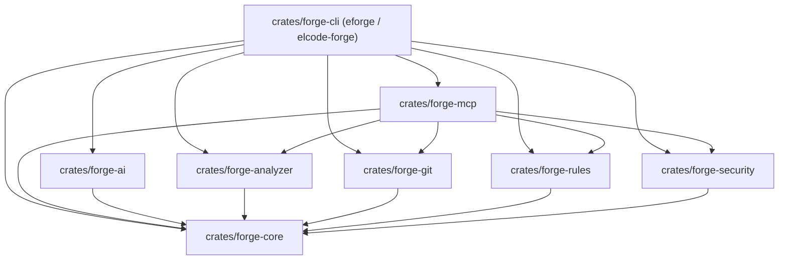

# ELCODE Forge (`eforge`)

> **Know your code. Ship with confidence.**  
> Deterministic Codebase Intelligence, Architecture Analysis, Change Blast-Radius, Release Readiness & Native MCP Engine — built in Rust by **ELCODE**.

[](https://github.com/elcode-id/elcode-forge/releases)
[](./LICENSE)
[](https://www.rust-lang.org)

---

## Why ELCODE Forge?

Modern codebases grow faster than teams can map them—especially with AI-assisted coding. Most developer tools either check syntax at the single-file level (linters) or send unindexed source trees to an LLM and hope for the best.

**ELCODE Forge (`eforge`)** is a **local-first, deterministic codebase intelligence layer**. Before any AI model or code reviewer looks at a repository, `eforge` builds a normalized **Intermediate Representation (IR)** of your repository's files, module boundaries, import graph, circular dependencies, npm/pnpm/Cargo manifest hygiene, Git blast radius, security/secret signals, and an **explainable 8-dimension Health Score**—and exposes it via both a fast CLI and a native **Model Context Protocol (MCP)** server (`eforge mcp`).

### Core Engineering Principles
- **Deterministic before generative:** Identical repository state + identical `eforge.config.yaml` always produces byte-for-byte identical JSON, Markdown, and SARIF v2.1.0 output.
- **Zero-Panic Guarantee:** Built in a strict Rust workspace (`unsafe_code = "forbid"`, zero `.unwrap()`/`.expect()` in production crates).
- **Local-First & Hostile-Input Safe:** Never executes arbitrary project scripts during scans, enforces canonical path-traversal guards (`../`), wraps MCP tool responses inside an `UntrustedEnvelope<T>` with prompt-injection signal detection, and automatically masks detected secrets (`****REDACTED****`).
- **Collision-Free CLI & Cache:** Primary binary is **`eforge`** (with secondary alias `elcode-forge`), configuration is **`eforge.config.yaml`** (with automatic fallback to `forge.config.yaml`), and incremental BLAKE3 cache state lives in **`.eforge/`**.

---

## Key Capabilities

| Capability | Description |
| :--- | :--- |
| **Fast Project Diagnosis (`eforge doctor`)** | Diagnoses repository inventory, languages, frameworks (`nextjs`, `nuxt`, `sveltekit`, `react`, `vue`, `svelte`), lockfile hygiene (`package-lock.json`, `pnpm-lock.yaml`, `Cargo.lock`), test suite presence, and secret exposure in **< 5 seconds** (~4–18ms on small/medium repos). |
| **Architecture Graph & Cycle Detection (`eforge graph`)** | Infers logical module boundaries from TypeScript/JavaScript and `.vue`/`.svelte` Single-File Component (SFC) imports (relative, index resolution, `@/` and `~/` aliases) and detects circular dependencies via **Tarjan's Strongly Connected Components (SCC)** algorithm. |
| **Configurable Architectural & Quality Rules** | Enforces `arch/no-direct-db-in-ui`, `arch/no-circular-dependencies`, `quality/require-service-tests`, and `quality/max-file-lines` with per-rule overrides (`enabled`, `severity`, `max_lines`) in `eforge.config.yaml`. |
| **Dependency Health Intelligence (`eforge dependencies`)** | Parses `package.json`, `package-lock.json`, and `pnpm-lock.yaml` to flag unused production dependencies (`deps/unused-dependency`), wildcard/unpinned versions (`deps/unpinned-version`), and duplicate declarations (`deps/duplicate-dependency`). |
| **Security & Secret Hygiene (`eforge security`)** | Detects hardcoded API keys, tokens, and PEM private keys (`security/hardcoded-secret`, `security/private-key`) with automatic redaction, plus unsafe JS/TS/SFC patterns (`eval`, `new Function`, `dangerouslySetInnerHTML`, `child_process.exec`, permissive CORS). |
| **Git Diff & Blast-Radius Impact (`eforge review`, `eforge diff`)** | Parses unified Git diffs, traverses reverse module dependencies via BFS to separate **directly affected** vs. **transitively affected** modules, flags modified files lacking tests, and computes an explainable **Change Risk Level** (`LOW`, `MEDIUM`, `HIGH`, `CRITICAL`). |
| **Automated Onboarding & Living Docs (`eforge onboard`, `eforge docs`)** | Generates a 5-file deterministic documentation bundle (`architecture.md`, `modules.md`, `dependencies.md`, `onboarding.md`, `risks.md`) with Mermaid `flowchart TD` diagrams in `docs/forge/`. |
| **Project & Module Explainer (`eforge explain [target]`)** | Explains the structural role, files, outgoing imports, incoming dependents, exported symbols, and related findings for the whole repository or any specific module/file path, with optional AI synthesis (`--ai`). |
| **Grounded AI PR Review (`eforge ai-review`)** | Combines deterministic change risk, blast radius, and rule findings with grounded AI insights classified as `Confirmed`, `Probable`, or `Suggestion` under strict deterministic guards. |
| **AI Governance & Privacy (`eforge ai status\|usage`)** | Supports local-only AI execution (Ollama, LM Studio), prompt-injection defense envelopes, in-flight secret redaction, daily USD spend ceilings, and SHA-256 caching. |
| **Native MCP Server (`eforge mcp`)** | Exposes 6 deterministic `eforge_*` tools over JSON-RPC 2.0 stdio with `UntrustedEnvelope<T>` isolation and prompt-injection signal scanning. |
| **Explainable 8-Dimension Health Score** | Computes weighted scores (`0..=100`) across *Architecture (20%)*, *Security (20%)*, *Maintainability (15%)*, *Testing (15%)*, *Dependencies (10%)*, *Documentation (10%)*, *Performance (5%)*, and *CI/CD (5%)* with explicit human-readable deduction reasons. |

---

## Installation

### Prerequisites
- **Rust Toolchain:** `rustup` (`rustc >= 1.75`, `cargo`)
- **Git:** Required for working-tree diff and hotspot analysis (`eforge review`, `eforge diff`)

### Build & Install from Source
```bash
git clone https://github.com/elcode-id/elcode-forge.git
cd elcode-forge

# Install the `eforge` (and `elcode-forge`) binary to ~/.cargo/bin
cargo install --path crates/forge-cli
```

Verify installation:
```bash
eforge --version
# ELCODE Forge (eforge) v0.4.0
```

---

## Quick Start (The Golden Path)

### 1. Initialize Configuration (`eforge init`)
Generates a starter `eforge.config.yaml` and initializes the `.eforge/` incremental cache directory:
```bash
eforge init --path .
```

### 2. Run a Fast Diagnostic Check (`eforge doctor`)
```bash
eforge doctor --path .
```
```text
ELCODE Forge Doctor
-------------------
[ OK ] Repository inventory: Discovered 71 source/config file(s)
[ OK ] Language & framework detection: Languages: [rust], Frameworks: []
[ OK ] Cargo manifest & lockfile hygiene: Cargo.toml present, Cargo.lock present: true
[ OK ] Automated test suite: Found 26 test file(s)
[ OK ] Security & secret hygiene: No hardcoded secrets or unsafe patterns detected

Summary: 0 warning(s) in 18ms
```

### 3. Execute a Full or Incremental Scan (`eforge scan`)
```bash
# Human-readable terminal report
eforge scan --path .

# Incremental scan using .eforge/metadata.json BLAKE3 hashes
eforge scan --path . --incremental

# Export OASIS SARIF v2.1.0 for GitHub Code Scanning
eforge scan --path . --format sarif --output eforge.sarif

# Enforce CI policy gate (non-zero exit code if High or Critical findings exist)
eforge scan --path . --fail-on high --format github
```

### 4. Focused Architecture, Dependency, Security & Explain Workflows
```bash
# Export Mermaid architecture graph
eforge graph --path . --format markdown

# Inspect npm/pnpm dependency health
eforge dependencies --path . --format terminal

# Run dedicated secret & unsafe pattern security scan
eforge security --path . --format sarif

# Explain a specific module's files, imports, dependents, exports, and findings
eforge explain src/services --path fixtures/next-app --format markdown

# Generate deterministic 5-file onboarding & architecture documentation in docs/forge/
eforge onboard --path .
```

### 5. Review Working-Tree Changes & Blast Radius (`eforge review` & `eforge diff`)
```bash
# Fast diff-scoped review in Markdown format (ideal for PR comments)
eforge review --fast --path . --format markdown

# Inspect direct and transitive module blast radius
eforge diff --path . --format terminal
```

### 6. AI-Assisted Explanations & Grounded PR Review
```bash
# Explain architecture or modules with AI-synthesized, grounded answers
eforge explain src/services --ai

# Preview prompt context pack & token estimates without making network calls
eforge explain src/services --ai --dry-run

# Run grounded AI PR review with Confirmed | Probable | Suggestion items
eforge ai-review --fast --fail-on high

# Check AI provider connectivity and inspect token spend
eforge ai status --ping
eforge ai usage
```

---

## CLI Command Reference (16 Subcommands)

| Command | Key Flags | Description |
| :--- | :--- | :--- |
| `eforge init` | `--path <DIR>`, `--force` | Initializes `eforge.config.yaml` and `.eforge/` cache directory. |
| `eforge doctor` | `--path <DIR>`, `--format <FMT>` | Runs a `< 5s` diagnostic check across repository inventory, manifest hygiene, tests, and secrets. |
| `eforge scan` | `--path <DIR>`, `--incremental`, `--full`, `--fail-on <SEV>`, `--format <FMT>`, `-o <FILE>` | Runs full or incremental architecture, dependency, rule, security, and 8-dimension health analysis. |
| `eforge review` | `--path <DIR>`, `--fast`, `--changed`, `--fail-on <SEV>`, `--format <FMT>` | Computes change risk (`Low\|Medium\|High\|Critical`), blast radius, and findings for modified files. |
| `eforge diff` | `--path <DIR>`, `--format <FMT>` | Parses working-tree unified diff (`git diff HEAD`) and reports direct & transitive module impact. |
| `eforge dependencies` | `--path <DIR>`, `--format <FMT>` | Inspects `package.json` / lockfile dependencies, unused packages, and version hygiene. |
| `eforge security` | `--path <DIR>`, `--format <FMT>` | Runs focused secret detection and unsafe JS/TS/SFC pattern analysis with policy exit code evaluation. |
| `eforge graph` | `--path <DIR>`, `--format <FMT>` | Exports the module architecture graph (`terminal`, `json`, or Mermaid `flowchart TD` in `markdown`). |
| `eforge onboard` | `--path <DIR>`, `-o <OUT_DIR>` | Generates `architecture.md`, `modules.md`, `dependencies.md`, `onboarding.md`, and `risks.md`. |
| `eforge docs` | `--path <DIR>`, `-o <OUT_DIR>` | Alias for `eforge onboard` to regenerate living repository documentation (`docs/forge/`). |
| `eforge explain [target]` | `[TARGET]`, `--path <DIR>`, `--ai`, `--dry-run`, `--format <FMT>` | Explains files, imports, dependents, symbols, and findings; synthesizes answers with `--ai`. |
| `eforge ai-review` | `--base <REF>`, `--fast`, `--fail-on <SEV>`, `--dry-run`, `--no-cache` | Grounded PR review combining blast radius with `Confirmed`, `Probable`, and `Suggestion` items. |
| `eforge ai status` | `--ping`, `--path <DIR>` | Reports AI configuration, selected provider, model, and checks live endpoint latency with `--ping`. |
| `eforge ai usage` | `--path <DIR>`, `--format <FMT>` | Reports daily token consumption, accumulated USD cost, and daily budget ceiling. |
| `eforge report` | `--path <DIR>`, `--output <FILE>`, `--save-history`, `--no-git` | Generates a deterministic `ReportBundle` JSON for dashboard consumption and history snapshots. |
| `eforge serve` | `--port <PORT>`, `--path <DIR>`, `--static-dir <DIR>` | Serves a read-only, loopback-restricted HTTP API (`/api/v1/health`, `/api/v1/bundle`, `/api/v1/history`). |
| `eforge schema` | `--out-dir <DIR>` | Exports canonical JSON Schemas for `ReportBundle` and IR types. |
| `eforge mcp` | `--path <DIR>` | Starts the native Model Context Protocol (MCP) JSON-RPC 2.0 stdio server (`eforge_*` tools). |

**Supported `--format` values:** `terminal` (default), `json`, `markdown`, `sarif` (SARIF v2.1.0), `github` (GitHub Actions annotations + Markdown).

---

## Web Intelligence Dashboard (`apps/dashboard`)

ELCODE Forge provides a local-first, zero-telemetry Web Intelligence Dashboard built with SvelteKit, TypeScript, and Tailwind CSS. The dashboard operates in two complementary modes:

### 1. Static Standalone Mode
Generate a self-contained report bundle and load it offline into the dashboard SPA:
```bash
# Export the deterministic intelligence bundle
eforge report --path . --output report.json

# Open the dashboard SPA and load the JSON bundle
```

### 2. Live Interactive Mode
Run the local read-only daemon for real-time inspection, live auto-updates, and historical commit trends tracking:
```bash
# Save historical commit snapshots as you work
eforge report --save-history

# Start the read-only daemon (strictly bound to 127.0.0.1)
eforge serve --port 7878
```
Connect your dashboard to `http://127.0.0.1:7878` to view:
- **Overview:** 8-dimension health score ring, dimensions breakdown, and repository inventory.
- **Architecture:** Interactive module dependency canvas (Cytoscape + Dagre) with circular-dependency highlighting (`#ef4444`) and deep module inspector (`eforge explain` parity). Includes a keyboard-accessible module table as an accessible non-visual alternative.
- **Findings:** URL-synchronized filtering by severity, confidence, rule ID prefix, and file path with hostile plain-text evidence envelopes.
- **Security:** Redacted credential leakage detector, unsafe JS/TS pattern analysis, and mitigation steps.
- **Dependencies:** Direct vs dev packages, unpinned version warnings, and unused package flags.
- **Changes & Blast Radius:** Git diff change risk, direct vs transitive module propagation, and churn hotspots.
- **Trends & Evolution:** Historical health score trajectories, finding severity sparklines, and commit snapshot records.

---

## Native MCP Server (`eforge mcp`)

ELCODE Forge includes a built-in, zero-configuration **Model Context Protocol (MCP)** server over JSON-RPC 2.0 stdio (`protocolVersion: "2024-11-05"`), enabling AI coding assistants (Claude Code, Claude Desktop, Cursor, Windsurf, Google Antigravity) to query deterministic codebase intelligence without hallucinating architecture boundaries.

### MCP Client Configuration
Add `eforge` to your MCP client configuration (`mcp_config.json` / `.cursor/mcp.json` / `claude_desktop_config.json`):

```json
{
  "mcpServers": {
    "elcode-forge": {
      "command": "eforge",
      "args": ["mcp", "--path", "/absolute/path/to/your/repo"]
    }
  }
}
```

### Exposed `eforge_*` Tools

| Tool Name | Arguments | Description |
| :--- | :--- | :--- |
| `eforge_project_info` | `{}` | Returns repository profile, languages, frameworks, package managers, inventory counts, and 8-dimension health score. |
| `eforge_get_architecture` | `{}` | Returns the module architecture graph, inter-module imports, and detected circular dependency cycles. |
| `eforge_get_dependencies` | `{}` | Returns declared/locked dependencies and `deps/*` hygiene findings. |
| `eforge_get_findings` | `{ "severity"?: string, "rule_prefix"?: string }` | Returns sorted architectural, quality, dependency, and security findings with optional filters. |
| `eforge_get_change_impact` | `{ "diff_text"?: string }` | Computes direct/transitive module blast radius and change risk score for a unified diff or working tree. |
| `eforge_explain_module` | `{ "target": string }` | Explains matched modules, files, inbound dependents, outbound dependencies, and findings for `target`. |

### Prompt-Injection Defense (`UntrustedEnvelope<T>`)
Every MCP tool response is wrapped in a deterministic `UntrustedEnvelope<T>` (`trust_level: "untrusted_repository_data"`) that instructs the host LLM to treat repository text strictly as passive data and scans for prompt-injection signals (`override_previous_instructions`, `disregard_instructions`, `system_prompt_reference`, `role_hijack_attempt`, `chatml_delimiter_injection`, `command_execution_directive`, `exfiltration_directive`).

---

## GitHub Action (`elcode-id/forge-action`)

Use the composite GitHub Action in [`integrations/github-action`](./integrations/github-action/README.md) to gate pull requests and publish Markdown summaries + SARIF reports:

```yaml
- name: Run ELCODE Forge PR Review
  uses: ./integrations/github-action
  with:
    command: review
    path: .
    strict: "true"
    step-summary: "true"
```

---

## AI Architecture, Privacy & Cost Controls

ELCODE Forge adheres to a strict principle: **Generative AI is an advisory layer, never an authoritative judge.**

- **Local-First & Offline Support:** Native `openai-compatible` provider support for local models via **Ollama** (`http://localhost:11434/v1`) or **LM Studio** (`http://localhost:1234/v1`). Zero code leaves your workstation.
- **Untrusted Envelopes & Prompt Injection Defense:** All repository code, AST snippets, and git diffs are strictly wrapped in `<untrusted_repository_data>` envelopes.
- **Secret Redaction:** High-entropy credentials, private keys, and API tokens are detected and redacted (`[REDACTED_SECRET]`) prior to prompt construction.
- **Deterministic Grounding Guard:** The `apply_deterministic_guard` engine cross-verifies all AI review items against deterministic scan findings. `Confirmed` items require verifiable finding IDs, and hallucinated paths are dropped.
- **Cost Controls:** Pre-call context inspection (`--dry-run`), daily USD expenditure ceilings (`budget_daily_usd`), and deterministic SHA-256 prompt caching (`.eforge/ai-cache/`).

For full details, read [docs/AI_AND_PRIVACY.md](./docs/AI_AND_PRIVACY.md).

---

## Configuration (`eforge.config.yaml`)

ELCODE Forge reads **`eforge.config.yaml`** from the repository root (with automatic backward-compatible fallback to `forge.config.yaml`). If no config file is present, sensible defaults are used automatically.

```yaml
# ELCODE Forge (eforge) Configuration
version: "1"

project_name: "my-web-platform"
languages:
  - "typescript"
  - "javascript"

ignore_patterns:
  - "node_modules/**"
  - "dist/**"
  - "build/**"
  - ".next/**"
  - "coverage/**"
  - ".eforge/**"

git_enabled: true
fail_on_severity: "high"

# Optional per-rule overrides
rules:
  arch/no-direct-db-in-ui:
    enabled: true
    severity: "high"
  arch/no-circular-dependencies:
    enabled: true
    severity: "high"
  quality/require-service-tests:
    enabled: true
    severity: "medium"
  quality/max-file-lines:
    enabled: true
    severity: "low"
    max_lines: 400

# Optional AI Assistant & Review Configuration
# ai:
#   enabled: false
#   provider: "openai"              # openai | anthropic | gemini | openai-compatible | mock
#   model: "gpt-4o"
#   # base_url: "http://localhost:11434/v1" # Local Ollama / LM Studio
#   budget_daily_usd: 2.00
```

---

## Deterministic Exit Codes (`0..=4`)

Designed for predictable CI/CD gates:

| Exit Code | Enum Variant | Meaning |
| :---: | :--- | :--- |
| `0` | `ExitCode::Success` | Execution succeeded; no findings exceeded the configured `--fail-on` threshold. |
| `1` | `ExitCode::FindingsAboveThreshold` | Architectural, quality, or dependency findings met or exceeded the threshold. |
| `2` | `ExitCode::ConfigurationError` | Invalid CLI arguments or malformed `eforge.config.yaml`. |
| `3` | `ExitCode::ExecutionError` | Unexpected I/O, filesystem, or runtime error. |
| `4` | `ExitCode::SecurityPolicyFailure` | Security or hardcoded-secret finding met or exceeded the threshold. |

---

## Workspace Architecture

`elcode-forge` is organized as a modular Rust workspace with a strict Directed Acyclic Graph (DAG) dependency boundary:



- **`crates/forge-core`** — Leaf crate: Normalized IR (`Repository`, `FileNode`, `Module`, `Dependency`, `Finding`, `HealthScore`), `ForgeConfig` & `RuleOverrideConfig` loader, canonical `path_guard`, `.eforge/` BLAKE3 cache, and 8-dimension scoring engine.
- **`crates/forge-analyzer`** — Gitignore-aware repository scanner, language/framework detector, `package.json` / `package-lock.json` / `pnpm-lock.yaml` dependency analyzer, and TS/JS + `.vue`/`.svelte` SFC import graph builder with Tarjan SCC cycle detection.
- **`crates/forge-git`** — Unified diff parser, commit hotspot analyzer, and reverse-import BFS blast-radius calculator.
- **`crates/forge-rules`** — Deterministic rule engine (`arch/no-direct-db-in-ui`, `arch/no-circular-dependencies`, `quality/require-service-tests`, `quality/max-file-lines`) with config overrides.
- **`crates/forge-security`** — Redacted secret scanner and unsafe JS/TS/SFC pattern detector.
- **`crates/forge-ai`** — Provider abstraction (`openai`, `anthropic`, `gemini`, `openai-compatible`), context pack builder, secret redaction, token budgeting, and response caching.
- **`crates/forge-mcp`** — Native Model Context Protocol (MCP) JSON-RPC 2.0 stdio server (`eforge_*` tool namespace) and `UntrustedEnvelope<T>` prompt-injection boundary.
- **`crates/forge-cli`** — CLI entrypoint (`eforge` & `elcode-forge`), 16 subcommands, and report formatters (`terminal`, `json`, `markdown`, `sarif`, `github`).
- **`integrations/github-action`** — Composite GitHub Action (`elcode-id/forge-action`).
- **`fixtures/`** — Curated deterministic test repositories (`fixtures/next-app`, `fixtures/vulnerable-ts-app`, `fixtures/ai-eval`).

---

## Development & Verification

Run the workspace verification suite:

```bash
# Format check
cargo fmt --all -- --check

# Strict Clippy linter (denies unwrap, expect, panic, todo, unimplemented, and warnings)
cargo clippy --workspace --all-targets -- -D warnings

# Run all unit and fixture integration tests
cargo test --workspace --lib --bins
```

---

## License

Released under the [MIT License](./LICENSE).  
Built with precision by **ELCODE** (Bandung, Indonesia).
