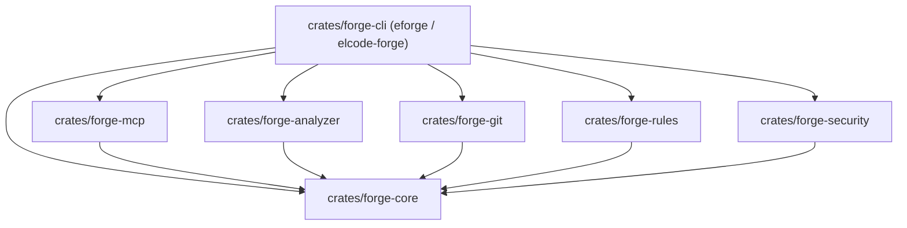

# ELCODE Forge (`eforge`)

> **Know your code. Ship with confidence.**  
> Deterministic Codebase Intelligence, Architecture Analysis, Change Blast-Radius & Release Readiness Engine — built in Rust by **ELCODE**.

[](https://github.com/elcode-id/elcode-forge/releases)
[](./LICENSE)
[](https://www.rust-lang.org)

---

## Why ELCODE Forge?

Modern codebases grow faster than teams can map them—especially with AI-assisted coding. Most developer tools either check syntax at the single-file level (linters) or send unindexed source trees to an LLM and hope for the best.

**ELCODE Forge (`eforge`)** is a **local-first, deterministic codebase intelligence layer**. Before any AI model or code reviewer looks at a repository, `eforge` builds a normalized **Intermediate Representation (IR)** of your repository's files, module boundaries, import graph, circular dependencies, npm manifest hygiene, Git blast radius, security/secret signals, and an **explainable 8-dimension Health Score**.

### Core Engineering Principles
- **Deterministic before generative:** Identical repository state + identical `eforge.config.yaml` always produces byte-for-byte identical JSON, Markdown, and SARIF v2.1.0 output.
- **Zero-Panic Guarantee:** Built in a strict Rust workspace (`unsafe_code = "forbid"`, zero `.unwrap()`/`.expect()` in production crates).
- **Local-First & Hostile-Input Safe:** Never executes arbitrary project scripts during scans, enforces canonical path-traversal guards (`../`), and automatically masks detected secrets (`****REDACTED****`).
- **Collision-Free CLI & Cache:** Primary binary is **`eforge`** (with secondary alias `elcode-forge`), configuration is **`eforge.config.yaml`** (with automatic fallback to `forge.config.yaml`), and incremental BLAKE3 cache state lives in **`.eforge/`**.

---

## Key Capabilities

| Capability | Description |
| :--- | :--- |
| **Fast Project Diagnosis (`eforge doctor`)** | Diagnoses repository inventory, languages, frameworks (`nextjs`, `nuxt`, `sveltekit`, `react`, `vue`), lockfile hygiene, test suite presence, and secret exposure in **< 5 seconds** (~4ms on small repos). |
| **Architecture Graph & Cycle Detection** | Infers logical module boundaries from TypeScript/JavaScript imports (relative, index resolution, `@/` and `~/` aliases) and detects circular dependencies via **Tarjan's Strongly Connected Components (SCC)** algorithm. |
| **Built-in Architectural & Quality Rules** | Enforces `arch/no-direct-db-in-ui`, `arch/no-circular-dependencies`, `quality/require-service-tests`, and `quality/max-file-lines`. |
| **Dependency Health Intelligence** | Parses `package.json` and lockfiles to flag unused production dependencies (`deps/unused-dependency`), wildcard/unpinned versions (`deps/unpinned-version`), and duplicate declarations (`deps/duplicate-dependency`). |
| **Security & Secret Hygiene** | Detects hardcoded API keys, tokens, and private keys (`security/hardcoded-secret`, `security/private-key`) with automatic redaction, plus unsafe JS/TS patterns (`eval`, `new Function`, `dangerouslySetInnerHTML`, `child_process.exec`, permissive CORS). |
| **Git Diff & Blast-Radius Impact (`eforge review`, `eforge diff`)** | Parses unified Git diffs, traverses reverse module dependencies via BFS to separate **directly affected** vs. **transitively affected** modules, flags modified files lacking tests, and computes an explainable **Change Risk Level** (`LOW`, `MEDIUM`, `HIGH`, `CRITICAL`). |
| **Explainable 8-Dimension Health Score** | Computes weighted scores (`0..=100`) across *Architecture (20%)*, *Security (20%)*, *Maintainability (15%)*, *Testing (15%)*, *Dependencies (10%)*, *Documentation (10%)*, *Performance (5%)*, and *CI/CD (5%)* with explicit human-readable deduction reasons. |
| **Multi-Format CI/CD Output** | Emits `terminal`, `json`, `markdown`, `github` (GitHub Actions workflow annotations), and **OASIS SARIF v2.1.0** (`sarif`) for GitHub Code Scanning. |

---

## Installation

### Prerequisites
- **Rust Toolchain:** `rustup` (`rustc >= 1.75`, `cargo`)
- **Git:** Required for working-tree diff and hotspot analysis (`eforge review`, `eforge diff`)

### Build & Install from Source
```bash
git clone https://github.com/elcode-id/elcode-forge.git
cd elcode-forge

# Install the `eforge` (and `elcode-forge`) binary to ~/.cargo/bin
cargo install --path crates/forge-cli
```

Verify installation:
```bash
eforge --version
# ELCODE Forge (eforge) v0.1.0
```

---

## Quick Start (The Golden Path)

### 1. Initialize Configuration (`eforge init`)
Generates a starter `eforge.config.yaml` and initializes the `.eforge/` incremental cache directory:
```bash
eforge init --path .
```

### 2. Run a Fast Diagnostic Check (`eforge doctor`)
```bash
eforge doctor --path .
```
Or output machine-readable JSON:
```bash
eforge doctor --path fixtures/next-app --format json
```
```json
{
  "repository_detected": true,
  "checks": [
    {
      "label": "Repository inventory",
      "passed": true,
      "warning": false,
      "detail": "Discovered 6 source/config file(s)"
    },
    {
      "label": "Language & framework detection",
      "passed": true,
      "warning": false,
      "detail": "Languages: [typescript], Frameworks: [nextjs, react]"
    },
    {
      "label": "Node.js manifest & lockfile hygiene",
      "passed": true,
      "warning": true,
      "detail": "7 dependency(ies) declared, lockfile present: false, duplicates: 0"
    }
  ],
  "warnings_count": 2,
  "duration_ms": 4
}
```

### 3. Execute a Full or Incremental Scan (`eforge scan`)
```bash
# Human-readable terminal report
eforge scan --path .

# Incremental scan using .eforge/metadata.json BLAKE3 hashes
eforge scan --path . --incremental

# Export OASIS SARIF v2.1.0 for GitHub Code Scanning
eforge scan --path . --format sarif --output eforge.sarif

# Enforce CI policy gate (non-zero exit code if High or Critical findings exist)
eforge scan --path . --fail-on high --format github
```

### 4. Review Working-Tree Changes & Blast Radius (`eforge review` & `eforge diff`)
```bash
# Fast diff-scoped review in Markdown format (ideal for PR comments)
eforge review --fast --path . --format markdown

# Inspect direct and transitive module blast radius
eforge diff --path . --format terminal
```

---

## CLI Command Reference

| Command | Key Flags | Description |
| :--- | :--- | :--- |
| `eforge init` | `--path <DIR>`, `--force` | Initializes `eforge.config.yaml` and `.eforge/` cache directory. |
| `eforge doctor` | `--path <DIR>`, `--format <FMT>` | Runs a `< 5s` diagnostic check across repository inventory, manifest hygiene, tests, and secrets. |
| `eforge scan` | `--path <DIR>`, `--incremental`, `--full`, `--fail-on <SEV>`, `--format <FMT>`, `-o <FILE>` | Runs full or incremental architecture, dependency, rule, security, and 8-dimension health analysis. |
| `eforge review` | `--path <DIR>`, `--fast`, `--changed`, `--fail-on <SEV>`, `--format <FMT>` | Computes change risk (`Low\|Medium\|High\|Critical`), blast radius, and findings for modified files. |
| `eforge diff` | `--path <DIR>`, `--format <FMT>` | Parses working-tree unified diff (`git diff HEAD`) and reports direct & transitive module impact. |

**Supported `--format` values:** `terminal` (default), `json`, `markdown`, `sarif` (SARIF v2.1.0), `github` (GitHub Actions annotations + Markdown).

---

## Configuration (`eforge.config.yaml`)

ELCODE Forge reads **`eforge.config.yaml`** from the repository root (with automatic backward-compatible fallback to `forge.config.yaml`). If no config file is present, sensible defaults are used automatically.

```yaml
# ELCODE Forge (eforge) Configuration
version: "1"

project_name: "my-web-platform"
languages:
  - "typescript"
  - "javascript"

ignore_patterns:
  - "node_modules/**"
  - "dist/**"
  - "build/**"
  - ".next/**"
  - "coverage/**"
  - ".eforge/**"

git_enabled: true
fail_on_severity: "high"
```

---

## Deterministic Exit Codes (`0..=4`)

Designed for predictable CI/CD gates:

| Exit Code | Enum Variant | Meaning |
| :---: | :--- | :--- |
| `0` | `ExitCode::Success` | Execution succeeded; no findings exceeded the configured `--fail-on` threshold. |
| `1` | `ExitCode::FindingsAboveThreshold` | Architectural, quality, or dependency findings met or exceeded the threshold. |
| `2` | `ExitCode::ConfigurationError` | Invalid CLI arguments or malformed `eforge.config.yaml`. |
| `3` | `ExitCode::ExecutionError` | Unexpected I/O, filesystem, or runtime error. |
| `4` | `ExitCode::SecurityPolicyFailure` | Security or hardcoded-secret finding met or exceeded the threshold. |

---

## Workspace Architecture

`elcode-forge` is organized as a modular Rust workspace with a strict Directed Acyclic Graph (DAG) dependency boundary:



- **`crates/forge-core`** — Leaf crate: Normalized IR (`Repository`, `FileNode`, `Module`, `Dependency`, `Finding`, `HealthScore`), `ForgeConfig` loader, canonical `path_guard`, `.eforge/` BLAKE3 cache, and 8-dimension scoring engine.
- **`crates/forge-analyzer`** — Gitignore-aware repository scanner, language/framework detector, `package.json` & lockfile dependency analyzer, and TS/JS import graph builder with Tarjan SCC cycle detection.
- **`crates/forge-git`** — Unified diff parser, commit hotspot analyzer, and reverse-import BFS blast-radius calculator.
- **`crates/forge-rules`** — Deterministic rule engine (`arch/no-direct-db-in-ui`, `arch/no-circular-dependencies`, `quality/require-service-tests`, `quality/max-file-lines`).
- **`crates/forge-security`** — Redacted secret scanner and unsafe JS/TS pattern detector.
- **`crates/forge-mcp`** — Native Model Context Protocol (MCP) server (`eforge_*` tool namespace).
- **`crates/forge-cli`** — CLI entrypoint (`eforge` & `elcode-forge`) and report formatters (`terminal`, `json`, `markdown`, `sarif`, `github`).
- **`fixtures/`** — Curated deterministic test repositories (`fixtures/next-app`, `fixtures/vulnerable-ts-app`).

---

## Development & Verification

Run the workspace verification suite:

```bash
# Format check
cargo fmt --all -- --check

# Strict Clippy linter (denies unwrap, expect, panic, todo, unimplemented, and warnings)
cargo clippy --workspace --all-targets -- -D warnings

# Run all unit and fixture integration tests
cargo test --workspace --lib --bins
```

---

## License

Released under the [MIT License](./LICENSE).  
Built with precision by **ELCODE** (Bandung, Indonesia).
