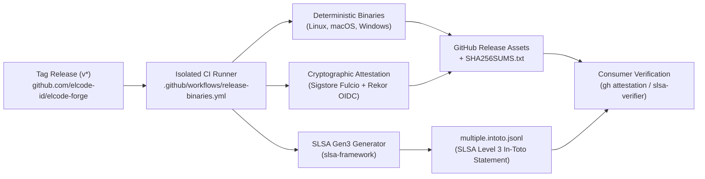

# ELCODE Forge Cryptographic Verification Guide — SLSA Level 3 & Sigstore Provenance

> *"Software should feel like an instrument, not a compromise."*  
> *"Code quality is visible in product behavior, speed, and durability."*  
> — [ELCODE Studio Manifesto](https://elcode.id/)

---

## 1. Executive Summary & Zero-Trust Supply Chain Architecture

ELCODE Forge (`eforge`) provides enterprise-grade, deterministic software intelligence and governance. In zero-trust enterprise environments, running third-party developer binaries without cryptographic verification introduces unacceptable supply-chain risks (e.g., SolarWinds, Codecov-style CI compromises, artifact tampering, or man-in-the-middle CDN injection).

To guarantee absolute binary integrity and source-to-binary traceability, all official ELCODE Forge releases are produced under **SLSA (Supply-chain Levels for Software Artifacts) Build Level 3** standards:



### Trust Guarantees
- **SLSA Level 3 Non-Forgeability:** Binaries are compiled in isolated, ephemeral runners. Build parameters and source commit SHAs cannot be forged by unauthorized parties.
- **Keyless Cryptographic Signing:** Attestations use OpenID Connect (OIDC) identities issued by GitHub's Sigstore Fulcio Certificate Authority and recorded immutably on the Rekor transparency log. No long-lived private keys exist that could be leaked or compromised.
- **Multi-Factor Verification:** Users can independently verify releases using GitHub Artifact Attestations, the OpenSSF `slsa-verifier`, or deterministic SHA-256 checksums.

---

## 2. Supported Verification Methods Matrix

| Method | Tool Required | Verification Level | Protected Against |
| :--- | :--- | :--- | :--- |
| **Method 1: GitHub Artifact Attestation** | GitHub CLI (`gh` >= 2.49.0) | **Cryptographic (Sigstore)** | Binary tampering, unauthorized builds, compromised release credentials |
| **Method 2: SLSA Level 3 Provenance** | `slsa-verifier` (OpenSSF) | **SLSA Level 3 (In-Toto)** | CI build parameter modification, source spoofing, rogue runner injection |
| **Method 3: SHA-256 Checksum Matrix** | `sha256sum`, `shasum`, or `pwsh` | **Digest Integrity** | File corruption, partial download, storage decay |

---

## 3. Method 1: Cryptographic Verification via GitHub CLI (`gh attestation`)

The GitHub CLI provides built-in attestation verification against the Sigstore public transparency log. This is the fastest and most convenient verification method.

### 3.1 Download Release Artifacts
```bash
# Set version to verify
export FORGE_VERSION="v1.0.0"
export TARGET="x86_64-unknown-linux-gnu"

# Download the release archive
gh release download "$FORGE_VERSION" \
  --repo elcode-id/elcode-forge \
  --pattern "eforge-${FORGE_VERSION}-${TARGET}.tar.gz"
```

### 3.2 Verify Attestation
Execute `gh attestation verify` targeting the `elcode-id` organization:

```bash
gh attestation verify "eforge-${FORGE_VERSION}-${TARGET}.tar.gz" --owner elcode-id
```

### 3.3 Expected Verification Output
```text
Loaded digest sha256:d8c5... for eforge-v1.0.0-x86_64-unknown-linux-gnu.tar.gz
Loaded 1 attestation from GitHub API
✓ Verification succeeded!

[Signed by GitHub OIDC]
Repository:       elcode-id/elcode-forge
Workflow:         .github/workflows/release-binaries.yml
Source Ref:       refs/tags/v1.0.0
Commit SHA:       3c90c4b...
Issued At:        2026-10-29T12:00:00Z
Rekor Log Index:  148920114
```

> [!NOTE]
> If an attacker tampers with the binary archive or uploads an artifact built outside our official workflow, `gh attestation verify` will fail with an error code and reject the payload immediately.

---

## 4. Method 2: SLSA Level 3 Provenance Verification (`slsa-verifier`)

For high-assurance enterprise compliance (e.g., SOC 2 Type II, FedRAMP, ISO 27001), use the official OpenSSF [`slsa-verifier`](https://github.com/slsa-framework/slsa-verifier) to validate the signed in-toto statement.

### 4.1 Install `slsa-verifier`
- **macOS / Linux (Homebrew):**
  ```bash
  brew install slsa-verifier
  ```
- **Go CLI:**
  ```bash
  go install github.com/slsa-framework/slsa-verifier/v2/cli/slsa-verifier@latest
  ```
- **Standalone Binary:**
  Download from [slsa-framework/slsa-verifier releases](https://github.com/slsa-framework/slsa-verifier/releases).

### 4.2 Download Artifact and Provenance Statement
```bash
export FORGE_VERSION="v1.0.0"

# Download binary archive and the signed in-toto provenance statement
gh release download "$FORGE_VERSION" \
  --repo elcode-id/elcode-forge \
  --pattern "eforge-${FORGE_VERSION}-x86_64-unknown-linux-gnu.tar.gz" \
  --pattern "multiple.intoto.jsonl"
```

### 4.3 Verify Provenance
Run `slsa-verifier` specifying the exact source URI and release tag:

```bash
slsa-verifier verify-artifact "eforge-${FORGE_VERSION}-x86_64-unknown-linux-gnu.tar.gz" \
  --provenance-path multiple.intoto.jsonl \
  --source-uri github.com/elcode-id/elcode-forge \
  --source-tag "$FORGE_VERSION"
```

### 4.4 Expected Verification Output
```text
Verified SLSA provenance!
PASSED: Verified SLSA provenance

Producer:
  Builder: https://github.com/slsa-framework/slsa-github-generator/.github/workflows/generator_generic_slsa3.yml@refs/tags/v2.1.0
  Build Invocation ID: https://github.com/elcode-id/elcode-forge/actions/runs/40820706850

Recipe:
  Type: https://slsa.dev/provenance/v1
  Source URI: github.com/elcode-id/elcode-forge
  Source Tag: v1.0.0
  Source Commit: 3c90c4b...
  EntryPoint: .github/workflows/release-binaries.yml

Materials:
  URI: git+https://github.com/elcode-id/elcode-forge@refs/tags/v1.0.0
  Digest: 3c90c4b...
```

---

## 5. Method 3: Deterministic SHA-256 Checksum Verification

Every release publishes a unified `SHA256SUMS.txt` containing SHA-256 digests of all platform archives.

### 5.1 Download Artifact and Checksum File
```bash
gh release download "$FORGE_VERSION" \
  --repo elcode-id/elcode-forge \
  --pattern "eforge-${FORGE_VERSION}-*.tar.gz" \
  --pattern "SHA256SUMS.txt"
```

### 5.2 Validate Digest
- **Linux:**
  ```bash
  sha256sum -c SHA256SUMS.txt --ignore-missing
  ```
- **macOS:**
  ```bash
  shasum -a 256 -c SHA256SUMS.txt --ignore-missing
  ```
- **Windows (PowerShell):**
  ```powershell
  $Expected = (Get-Content SHA256SUMS.txt | Select-String "x86_64-pc-windows-msvc.zip").Line.Split(" ")[0]
  $Actual = (Get-FileHash -Algorithm SHA256 "eforge-$FORGE_VERSION-x86_64-pc-windows-msvc.zip").Hash.ToLower()
  if ($Expected -eq $Actual) {
      Write-Host "✓ Checksum verification succeeded!" -ForegroundColor Green
  } else {
      Write-Error "✕ Checksum mismatch! Expected $Expected but got $Actual"
  }
  ```

---

## 6. Enterprise Ingestion & CI/CD Pipeline Integration

### 6.1 Hardened Dockerfile Ingestion
Below is an example of verifying and installing `eforge` in a security-conscious multi-stage Docker build:

```dockerfile
# Stage 1: Secure Ingestion & Provenance Gate
FROM alpine:3.20 AS verifier

ARG FORGE_VERSION=v1.0.0
ARG TARGET=x86_64-unknown-linux-gnu

RUN apk add --no-cache curl github-cli ca-certificates tar

WORKDIR /verify
RUN gh release download "${FORGE_VERSION}" \
      --repo elcode-id/elcode-forge \
      --pattern "eforge-${FORGE_VERSION}-${TARGET}.tar.gz" \
      --pattern "SHA256SUMS.txt"

# 1. Digest Integrity Gate
RUN sha256sum -c SHA256SUMS.txt --ignore-missing

# 2. Cryptographic Attestation Gate
RUN gh attestation verify "eforge-${FORGE_VERSION}-${TARGET}.tar.gz" --owner elcode-id

# 3. Safe Extraction
RUN tar -xzf "eforge-${FORGE_VERSION}-${TARGET}.tar.gz"

# Stage 2: Minimal Runtime Image
FROM debian:bookworm-slim
COPY --from=verifier /verify/eforge-*/eforge /usr/local/bin/eforge
COPY --from=verifier /verify/eforge-*/elcode-forge /usr/local/bin/elcode-forge

RUN chmod +x /usr/local/bin/eforge /usr/local/bin/elcode-forge
ENTRYPOINT ["eforge"]
```

### 6.2 GitHub Actions Reusable Step
When incorporating `eforge` into downstream CI/CD workflows:

```yaml
- name: Download & Verify ELCODE Forge Binary
  env:
    GH_TOKEN: ${{ github.token }}
  run: |
    VERSION="v1.0.0"
    gh release download "$VERSION" --repo elcode-id/elcode-forge --pattern "eforge-${VERSION}-x86_64-unknown-linux-gnu.tar.gz"
    gh attestation verify "eforge-${VERSION}-x86_64-unknown-linux-gnu.tar.gz" --owner elcode-id
    tar -xzf "eforge-${VERSION}-x86_64-unknown-linux-gnu.tar.gz"
    sudo mv eforge-*/eforge /usr/local/bin/
    eforge --version
```

---

## 7. Security Invariants & Zero-Trust Guarantees

1. **Non-Forgeable Builder Isolation:** Artifact compilation occurs on isolated GitHub-hosted runners with no write access to external infrastructure during compilation.
2. **Deterministic Outputs:** Release archives contain only deterministic artifacts (`eforge`, `elcode-forge`, `README.md`, `LICENSE`), compiled with `--locked` dependencies and strict compiler lints.
3. **Public Rekor Transparency Log:** Every signature is published to the public Sigstore Rekor ledger. Any unauthorized signature attempted using forged credentials can be publicly detected and revoked.
4. **No Binary Self-Verification Paradoxes:** Verification relies solely on independent, open-source verification tools (`gh`, `slsa-verifier`, `sha256sum`) rather than an unverified `eforge` binary checking itself.

---

## 8. Incident Response & Reporting

If an attestation verification check fails:
1. **DO NOT** execute or unpack the binary.
2. Retain the downloaded artifact and the error log output from `gh attestation verify` or `slsa-verifier`.
3. Report the anomaly immediately to the ELCODE Studio Security Team at **`security@elcode.id`**.
4. Check the [ELCODE Forge Security Advisories](https://github.com/elcode-id/elcode-forge/security/advisories) for status updates or incident notices.
